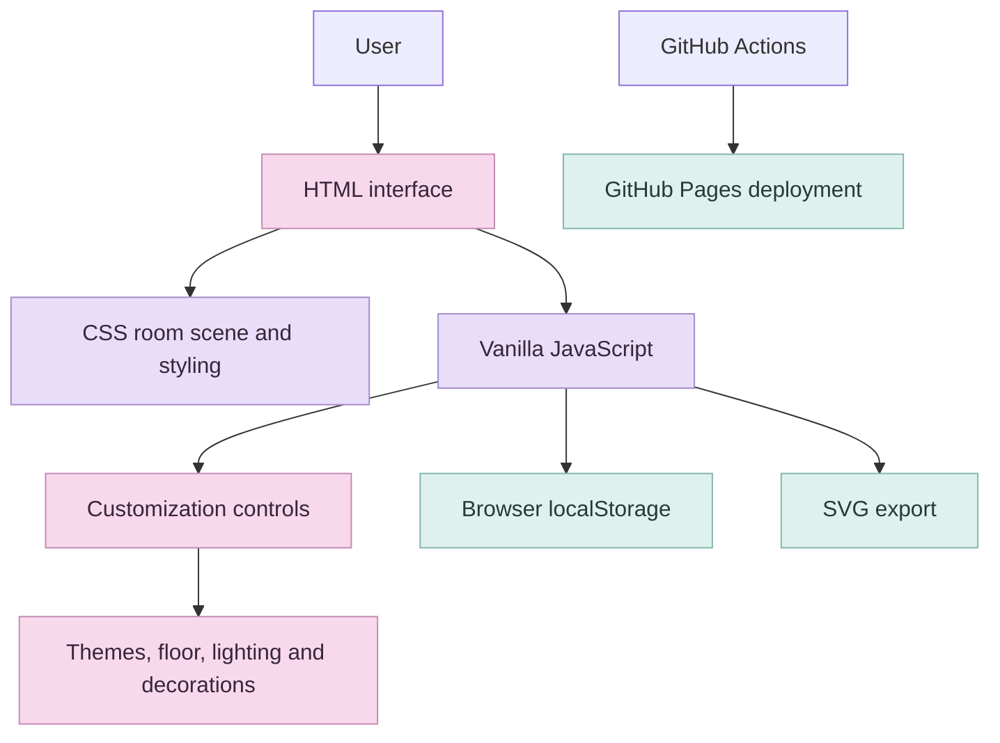

# ✦ My Gaming Room — Y2K Edition

> Design your own little gaming sanctuary with a playful Y2K aesthetic and an isometric room preview.


[](https://github.com/johannafoolchand/my-gaming-room/actions/workflows/deploy.yml)

My Gaming Room is a small front-end project built around a simple idea: create a customizable gaming room directly in the browser. The visual direction takes inspiration from early-2000s internet culture, pastel colors, gamer setups and playful decorative details.

## Project at a glance

| Area | Implementation |
| --- | --- |
| Interface | HTML5 |
| Styling | CSS3, responsive layouts and isometric shapes |
| Interactions | Vanilla JavaScript and DOM events |
| Room customization | Wall themes, floor styles, lighting and decorations |
| Persistence | Browser `localStorage` |
| Export | SVG |
| Deployment | GitHub Pages with GitHub Actions |

## Features

- Isometric gaming-room scene built with HTML and CSS
- Y2K-inspired visual identity with pastel themes and decorative details
- Customizable wall palettes and floor styles
- Lighting controls and adjustable ambient glow
- Add, move and remove room decorations
- Personalize the room name and gaming setup
- Save room preferences locally in the browser
- Export a room illustration as an SVG file
- Responsive layout for desktop and mobile screens

## Architecture

The project runs entirely in the browser. HTML defines the interface, CSS creates the room and its visual effects, and JavaScript manages user interactions and room state.



## Preview

The room is designed as a lightweight, browser-based experience rather than a full 3D application. Its isometric perspective is created with CSS shapes and layered elements.

## Requirements

- A modern web browser
- Python 3 (only if you want to run a local development server)
- No package manager or build tools required

## Run locally

Clone the repository:

```bash
git clone https://github.com/johannafoolchand/my-gaming-room.git
cd my-gaming-room
```

Start a local server:

```bash
python3 -m http.server 8000
```

Open [http://localhost:8000](http://localhost:8000) in your browser.

You can also open `index.html` directly, although using a local server is recommended when testing browser features.

## Project structure

```text
my-gaming-room/
├── .github/
│   └── workflows/
│       └── deploy.yml
├── index.html
├── styles.css
├── app.js
├── .gitignore
├── LICENSE
└── README.md
```

## Deployment

The repository includes a GitHub Actions workflow that publishes the site to GitHub Pages whenever changes are pushed to the `main` branch. The workflow can also be started manually from the Actions tab.

To enable deployment, make sure GitHub Pages is configured to use **GitHub Actions** as its build and deployment source in the repository settings.

## What this project demonstrates

- Structuring a front-end application with semantic HTML
- Building an isometric visual scene with CSS
- Creating interactive controls with vanilla JavaScript
- Managing browser-side state with `localStorage`
- Exporting generated content as an SVG file
- Automating static-site deployment with GitHub Actions

## Roadmap

- [ ] Add automated JavaScript tests
- [ ] Improve keyboard accessibility for room interactions
- [ ] Add more furniture, themes and decoration options
- [ ] Add a shareable room configuration
- [ ] Refine the mobile customization experience

---

Made with care by [Johanna Foolchand](https://github.com/johannafoolchand). ✦
