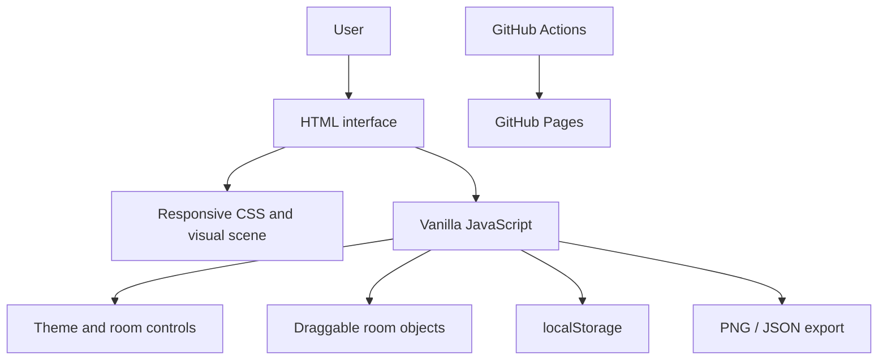

# ✦ Gaming Room Studio

> A cozy gaming-room designer blending Pinterest-inspired interiors, RGB setups and a virtual room-studio experience.


[](https://github.com/johannafoolchand/my-gaming-room/actions/workflows/deploy.yml)

Gaming Room Studio is a browser-based room-customization concept. It combines an immersive gaming-room visual, a dark glassmorphism interface, curated design moods and interactive controls for building a personal space.

## Project at a glance

| Area | Implementation |
| --- | --- |
| Interface | Semantic HTML5 |
| Visual system | Responsive CSS, glassmorphism, layered scene composition |
| Interactions | Vanilla JavaScript and DOM events |
| Customization | Themes, accent colors, lighting, room environments, floor finishes and draggable object markers |
| Persistence | Browser `localStorage` |
| Saved designs | Multiple locally stored room configurations |
| Export | PNG preview with JSON fallback |
| Deployment | GitHub Actions and GitHub Pages |

## Features

- Immersive gaming-room studio with a Pinterest-meets-gaming art direction
- Responsive three-column workspace with a dark translucent control panel
- Six visual themes and a configurable accent palette
- Lighting toggle, LED intensity and ambient modes
- Switch between three room environments (gaming studio, cozy bedroom and neon battlestation)
- Add, drag and remove visual room objects, including furniture, gaming gear and decor
- Rename the room and choose a floor finish
- Save, restore and delete multiple room configurations
- Export the room preview as PNG, with a JSON configuration fallback
- Responsive layout for desktop, tablet and mobile

## Architecture

The application is intentionally lightweight and runs in the browser without a build step.



## Run locally

Requirements: a modern browser and Python 3 for the optional local server.

```bash
git clone https://github.com/johannafoolchand/my-gaming-room.git
cd my-gaming-room
python3 -m http.server 8000
```

Open [http://localhost:8000](http://localhost:8000).

## Project structure

```text
my-gaming-room/
├── .github/
│   └── workflows/
│       └── deploy.yml
├── index.html
├── styles.css
├── app.js
├── .gitignore
└── README.md
```

## Deployment

The `deploy.yml` workflow publishes the static site to GitHub Pages on pushes to `main`. In repository settings, GitHub Pages must use **GitHub Actions** as its publishing source.

## What this project demonstrates

- Responsive interface composition with HTML and CSS
- State-driven UI updates using vanilla JavaScript
- Pointer-based drag interactions
- Browser persistence with `localStorage`
- Client-side image export and JSON downloads
- Continuous deployment of a static front-end project

---

Made with care by [Johanna Foolchand](https://github.com/johannafoolchand). ✦